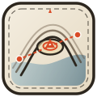
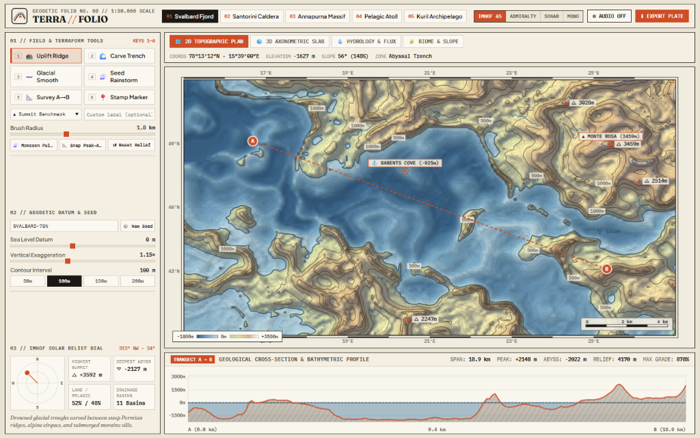

<div align="center">



# TERRA // FOLIO — Interactive Topographic & Bathymetric Cartography Atelier

**Sculpting relief, isolines, and watersheds in real time.** An interactive topographic and bathymetric cartography workbench featuring live Marching Squares contour extraction, Eduard Imhof solar relief shading, a rotatable 3D axonometric geological slab, D8 hydrological river routing, synchronized geological cross-section profiling, and procedural Web Audio field acoustics — engineered with zero dependencies.

[](https://freddy47588.github.io/terra-folio/)
[](./index.html)
[](./css/styles.css)
[](./js/main.js)
[](./js/audio.js)
[](./docs/ARCHITECTURE.md)

<br />



</div>

---

## ✨ Highlights

| Icon | Module | Description |
| :---: | --- | --- |
| 🗺️ | **Marching Squares Isoline Engine** | Real-time extraction of bold shoreline datums, minor hypsometric contours (`50m`–`200m`), `5×` index contours with inline elevation badges, and dashed bathymetric depth isolines at 60 FPS. |
| ☀️ | **Eduard Imhof Solar Relief Dial** | Interactive compass rose controlling solar azimuth (`0°–360°`) and altitude (`12°–82°`), casting warm alpine highlights and cool glacial shadows across ridges and valleys. |
| 🧊 | **3D Axonometric Terrain Slab** | Drag-to-orbit 3D geological block with translucent sea-level water volumes, exposed lithosphere cut-away walls, 3D draped isolines, and floating summit pins. |
| 💧 | **D8 Hydrology & Monsoon Erosion** | Steepest-descent D8 drainage network calculation plus live raindrop particles (`Seed Rainstorm` / `Monsoon`) that flow downhill along terrain gradients and carve river channels. |
| 📐 | **Geological Cross-Section (`A → B`)** | Draggable surveyor transect line with live geological strata profile, pelagic water column fill, vertical relief (`Δm`), steepest grade (`%`), and bi-directional hover sync. |
| ⛰️ | **Direct Canvas Terraforming** | Paint tectonic uplift ridges, carve fjords and volcanic calderas, smooth glacial valleys, or stamp custom named geodetic waypoints directly onto the map. |
| 🎨 | **4 Archival Print Editions** | Instant full-theme switching between **IMHOF 1965**, **ADMIRALTY 1888** (with compass rhumb lines), **SONAR // BATHY** (with live radar sweep), and **GEODETIC // MONO**. |
| 🔊 | **Procedural Field Acoustics & Export** | Zero-asset Web Audio surveyor clicks, benchmark pings, and elevation-reactive wind/pelagic soundscapes — plus a **`1600 × 1120` Archival Plate PNG Exporter**. |

---

## 🧭 Curated Geomorphological Expeditions

| Code | Expedition Name | Coordinates // Region | Seed | Geomorphological Character |
| :---: | --- | :---: | :---: | --- |
| `01` | 🏔️ **Svalbard Fjord & Glacier** | `78°13′N · 15°39′E` // High Arctic | `SVALBARD-78N` | Drowned glacial troughs carved between steep Permian ridges, cirques, and moraine sills. |
| `02` | 🌋 **Santorini Volcanic Caldera** | `36°23′N · 25°27′E` // Aegean Arc | `THERA-1600BC` | Collapsed ring-fault stratovolcano with lagoonal breach channels and a central resurgent dacite dome. |
| `03` | ⛰️ **Annapurna Massif & Gorge** | `28°35′N · 83°49′E` // Nepal Himalaya | `KALI-GANDAKI-83E` | Extreme `3,800m+` glaciated arêtes plunging directly into a deep antecedent river gorge. |
| `04` | 🏝️ **Pelagic Atoll & Abyssal Trench** | `11°21′N · 142°12′E` // Western Pacific | `CHALLENGER-11N` | Carbonate coral ring reef enclosing a lagoon atop a guyot seamount bordering a `1,900m` trench. |
| `05` | 🌊 **Kuril Shattered Archipelago** | `46°50′N · 151°52′E` // Okhotsk Basin | `SIMUSHIR-151E` | Tectonic island arc linked by shallow submarine saddles, tidal straits, and volcanic headlands. |

---

## 🎨 Archival Print Editions

| Edition | Inspiration | Palette & Cartographic Details |
| :---: | --- | --- |
| **IMHOF 65** | Eduard Imhof *Schweizerischer Mittelschulatlas* (1965) | Warm archival cream sheet (`#f2ece0`), olive-ochre-sienna hypsometric tints, Prussian blue bathymetry, vermilion survey marks (`#d94b27`). |
| **ADMIRALTY** | British Hydrographic Office Copperplate Charts (1888) | Antique parchment (`#eae0cc`), sepia contour linework, slate-teal shoal water, 16-point compass rhumb lines. |
| **SONAR** | Deep-Submergence Bathyscaphe Telemetry | Abyssal obsidian navy (`#07111a`), glowing emerald/cyan contour isolines, rotating radar sweep, amber benchmarks (`#fb923c`). |
| **MONO** | Contemporary Architectural Geodetic Print | Gallery white sheet (`#f4f4f1`), graphite hillshading, razor-sharp ink contours, International Orange accents (`#ff4411`). |

---

## ⌨️ Surveyor Controls & Shortcuts

| Key / Input | Tool / Action |
| :---: | --- |
| `1` | ⛰️ **Uplift Ridge** — Raise mountain peaks, volcanic cones, and tectonic ridges |
| `2` | 🌊 **Carve Trench** — Excavate fjords, calderas, abyssal trenches, and basins |
| `3` | 〰️ **Glacial Smooth** — Weather and level jagged terrain gradients |
| `4` | 🌧️ **Seed Rainstorm** — Spawn live hydrological water droplets that flow downhill and erode gullies |
| `5` | 📐 **Survey A→B** — Click and drag across the map to define a new geological cross-section line |
| `6` | 📍 **Stamp Marker** — Place named waypoints (`▲ Summit`, `⚓ Anchorage`, `♨ Vent`, `✦ Station`, `⛺ Camp`) |
| `Scroll Wheel` | Adjust brush radius in 2D Plan modes, or zoom camera in **3D Axonometric Slab** mode |
| `Drag in 3D Mode` | Orbit yaw and tilt pitch of the 3D geological terrain block |

---

## 📁 Project Structure

```text
terra-folio/
├── index.html              # Semantic cartographic workbench, instrument rack & canvases
├── README.md               # Project overview, badges, preview & quick start
├── .gitignore              # Ignored OS / IDE temporary files
├── assets/
│   ├── icon.svg            # Custom cartographic crest & contour SVG brand mark
│   ├── favicon.svg         # Browser tab SVG favicon
│   └── preview.png         # Verified desktop workbench screenshot
├── css/
│   └── styles.css          # 4 archival edition themes & responsive workbench layout
├── docs/
│   └── ARCHITECTURE.md     # Full technical architecture & algorithmic reference
└── js/
    ├── main.js             # App state orchestrator, pointer tools, sun dial & hotkeys
    ├── noise.js            # Seeded PRNG, 2D Simplex, ridged multifractal & 5 presets
    ├── terrain.js          # Float32 heightmap, D8 drainage routing, rain erosion & biomes
    ├── renderer.js         # Imhof hillshader, Marching Squares & 3D axonometric slab
    ├── transect.js         # Live geological cross-section & bathymetric profile analyzer
    ├── audio.js            # Zero-asset Web Audio surveyor clicks & elevation acoustics
    └── exporter.js         # High-resolution 1600×1120 archival PNG plate compositor
```

> 📖 **Full Technical Documentation:** Read [`docs/ARCHITECTURE.md`](./docs/ARCHITECTURE.md) for system architecture diagrams, Marching Squares contour extraction math, Eduard Imhof relief shading equations, D8 hydrological routing, and step-by-step guides to adding new presets or print editions.

---

## 🚀 Getting Started

Because the project uses native ES6 modules (`type="module"`), serve the folder over HTTP using any lightweight static server:

```bash
# Clone the repository
git clone https://github.com/Freddy47588/terra-folio.git
cd terra-folio

# Option 1: Python
python -m http.server 8094

# Option 2: Node.js
npx serve -l 8094
```

Then open **`http://localhost:8094`** in your browser.

---

## 🌐 Deployment

This project is 100% static HTML, CSS, and JavaScript with zero build steps required. It deploys directly to **GitHub Pages** (`Settings → Pages → Source: Deploy from branch main / root`), **Cloudflare Pages**, **Netlify**, or **Vercel**.
