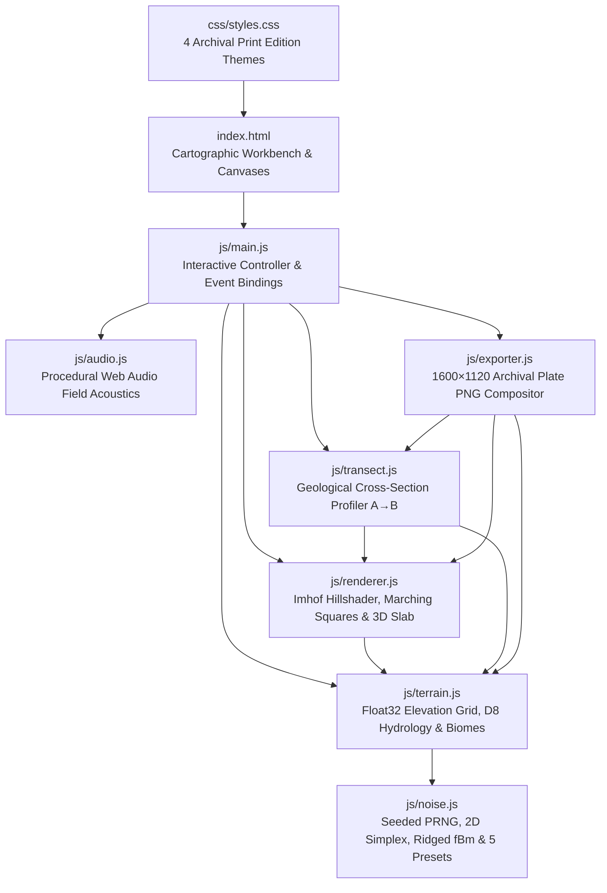

# Technical Documentation — TERRA // FOLIO Atelier

This document describes the system architecture, procedural geomorphology, Marching Squares contour extraction, Eduard Imhof relief hillshading, D8 hydrology, 3D axonometric terrain projection, and procedural Web Audio acoustics of **TERRA // FOLIO**.

---

## 1. System Architecture

**TERRA // FOLIO** is built with **zero runtime dependencies and zero build steps** using native ES6 modules (`type="module"`), high-DPI HTML5 2D Canvas pipelines, CSS custom properties for reactive archival edition theming, and procedural Web Audio API synthesis.



---

## 2. Directory Structure

```text
terra-folio/
├── index.html              # Semantic cartographic workbench, instrument rack & canvases
├── README.md               # Project overview, badges, preview, reference tables & guide
├── .gitignore              # Ignored OS / IDE temporary files
├── assets/
│   ├── icon.svg            # Custom cartographic crest & contour SVG brand mark
│   ├── favicon.svg         # Browser tab favicon
│   └── preview.png         # Verified desktop workbench screenshot
├── css/
│   └── styles.css          # 4 archival edition themes (Imhof, Admiralty, Sonar, Mono)
├── docs/
│   └── ARCHITECTURE.md     # Full technical architecture & algorithmic reference
└── js/
    ├── main.js             # App state orchestrator, pointer tools, sun dial & hotkeys
    ├── noise.js            # Deterministic xmur3/sfc32 PRNG, 2D Simplex & 5 presets
    ├── terrain.js          # Float32 heightmap, D8 drainage routing, rain erosion & biomes
    ├── renderer.js         # Offscreen hillshader, Marching Squares & 3D axonometric slab
    ├── transect.js         # Live geological cross-section & bathymetric profile analyzer
    ├── audio.js            # Zero-asset Web Audio surveyor clicks & elevation acoustics
    └── exporter.js         # High-resolution 1600×1120 archival PNG plate compositor
```

---

## 3. Core Mathematical & Rendering Pipelines

### 3.1 Deterministic Geomorphology (`js/noise.js`)

Every terrain seed string (e.g., `SVALBARD-78N`, `THERA-1600BC`, `KALI-GANDAKI-83E`) is hashed via `xmur3` into four 32-bit state words driving a deterministic `sfc32` pseudo-random number generator. This initializes the permutation tables of a custom `SimplexNoise2D` instance supporting:

- **Fractal Brownian Motion (`fbm`)** — Multi-octave gradient accumulation with configurable lacunarity (`2.05`) and gain (`0.5`).
- **Ridged Multifractal (`ridged`)** — Folding each octave (`1.0 - |n|`) and squaring the response to synthesize sharp alpine arêtes, fault scarps, and volcanic caldera rims.
- **Domain Warping (`warpedFbm`)** — Offsetting lookup coordinates `(x, y)` by secondary low-frequency noise fields to create organic tectonic folding and meandering glacial troughs.

### 3.2 Float32 Elevation Field & D8 Hydrology (`js/terrain.js`)

`TerrainEngine` maintains a `176 × 112` floating-point grid representing physical terrain spanning `24.0 km × 15.27 km` with elevations from `-2,400 m` (abyssal trench) to `+4,400 m` (alpine summit):

- **Non-Destructive Terraforming**: `baseGrid` stores the procedural geomorphology while `sculptGrid` accumulates user brush adjustments (`raise`, `lower`, `smooth`, and hydraulic droplet carving). Effective elevation is evaluated as:
  $$\text{elev}[i] = \text{clamp}(\text{baseGrid}[i] \times \text{exaggeration} + \text{sculptGrid}[i], -2400, 4400)$$
- **D8 Steepest-Descent Flow Accumulation**:
  1. All land cells above `seaLevel` are sorted in descending order of elevation.
  2. Each cell routes its accumulated precipitation flux (weighted by orographic altitude) to whichever of its 8 Moore neighbors maximizes the downward slope $\Delta z / \Delta d$.
  3. Cells exceeding the stream flux threshold (`34.0`) are traced downstream to sea level to construct variable-width river polylines.
- **Live Particle Rainstorms (`updateRainParticles`)**:
  - Raindrops spawn across mountain ridges and accelerate along the bilinear surface gradient $(-\partial z/\partial x, -\partial z/\partial y)$ with velocity damping, carving micro-gullies into `sculptGrid` as they descend toward the coast.

### 3.3 Eduard Imhof Hillshading & Marching Squares (`js/renderer.js`)

To achieve 60 FPS on high-DPI Retina displays, `CartographicRenderer` separates raster relief shading from vector cartographic linework:

1. **Offscreen Hypsometric & Relief Rasterizer**:
   - Computes central-difference surface normals $\mathbf{n} = (-\partial z/\partial x, -\partial z/\partial y, 1) / \|\cdot\|$ at each grid cell and takes the dot product with the 3D solar illumination vector $\mathbf{L}(\text{azimuth}, \text{altitude})$.
   - Applies Eduard Imhof's warm-sunlight / cool-shadow chromatic shift across the active edition's hypsometric and bathymetric lookup table (`imhof`, `admiralty`, `sonar`, `mono`).
2. **Marching Squares Isoline Extractor (`extractLevelSegments`)**:
   - Evaluates the 4-bit corner classification mask (`0`–`15`) for every grid cell against the sea-level coastline datum, minor contour intervals (`50m`–`200m`), `5×` index contours, and submerged bathymetric intervals.
   - Linearly interpolates exact edge crossings and batches line segments into single `ctx.stroke()` calls, placing inline elevation pills along index contours.

### 3.4 3D Axonometric Terrain Slab (`render3DBlockView`)

When switched to **🧊 3D AXONOMETRIC SLAB**, the renderer projects the elevation grid into an interactive 3D rotatable block:

- **Back-to-Front Painter's Traversal**: Dynamically flips row and column iteration direction based on camera yaw ($\sin\theta, \cos\theta$) so surface quads occlude accurately without a Z-buffer.
- **Translucent Pelagic Water Volume**: Renders both a translucent sea-level water surface plane and vertical cut-away water walls wherever the seabed dips below `seaLevel`.
- **Lithosphere Cut-Away Walls**: Closes the front-facing vertical faces of the terrain block down to the `-2,200 m` base datum, complete with draped 3D contours, the 3D transect path `A → B`, and floating waypoint callout flags.

### 3.5 Geological Cross-Section Profiler (`js/transect.js`)

`TransectProfiler` samples `181` bilinearly interpolated points along the geodesic line between handles `A` and `B`:

- Computes geodesic span (`km`), maximum summit, deepest sounding, total vertical relief (`Δm`), and maximum slope grade (`%`).
- Renders the cross-section with a pelagic water fill below `seaLevel`, diagonal metamorphic bedding hatches inside the lithosphere, and a bi-directional hover probe synced with the main 2D/3D map canvas.

### 3.6 Procedural Web Audio Field Acoustics (`js/audio.js`)

`FieldAudioEngine` synthesizes all sound effects directly via the Web Audio API:

- **Elevation-Reactive Ambient Filter**: A continuous pink-noise buffer routed through a high-Q bandpass filter whose center frequency glides from low pelagic resonance (`140 Hz` over deep ocean trenches) to crystalline alpine wind harmonics (`960 Hz` over `3,500 m+` peaks).
- **Instrument Transients**: Pitch-ramped triangle oscillators for surveyor caliper clicks, harmonic fifths (`D5` / `E4`) for benchmark stamping, and randomized high-frequency sine droplets during rainstorms.

---

## 4. Extending the Project

### Adding a New Geomorphological Expedition Preset
1. Open [`js/noise.js`](../js/noise.js) and append a new metadata entry to `EXPEDITION_PRESETS` with `id`, `code`, `name`, `region`, `seed`, `seaLevel`, `exaggeration`, `contourInterval`, `sunAzimuth`, `sunAltitude`, `transect`, and `description`.
2. Add a branch in `evaluatePresetElevation(presetId, u, v, simplex)` returning elevation in meters (`[-2000, +3800]`).
3. Add a corresponding `.preset-btn` button in [`index.html`](../index.html).

### Adding a New Archival Print Edition
1. Add a new theme palette object to `EDITIONS` in [`js/renderer.js`](../js/renderer.js) and a color ramp branch in `sampleColorRamp()`.
2. Add matching CSS custom properties under `html[data-edition="your-edition"]` in [`css/styles.css`](../css/styles.css).
